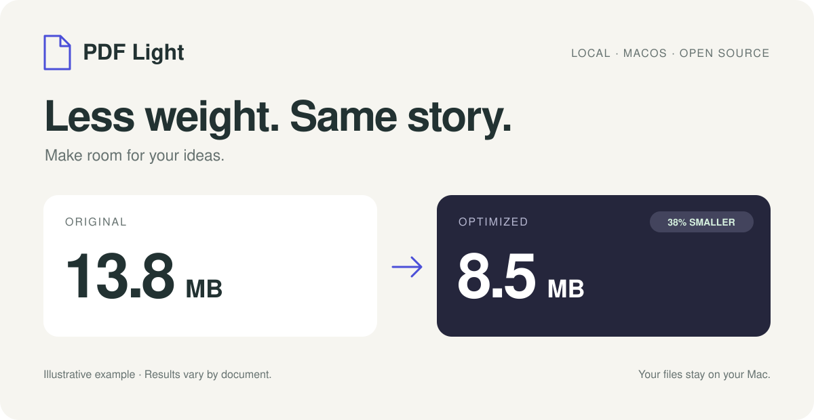

# PDF Light

**A small, local PDF optimizer for macOS. Built from a designer's real problem.**

[](LICENSE)


PDF Light makes PDFs lighter, checks their text and appearance, and can repair a narrowly defined mask issue that affects native macOS rendering. Drag in a document, choose a target size, compare the result, and save a separate copy. Processing happens on your Mac, with no account, uploads, analytics, or cloud service.



*Illustrative sizes, not a benchmark. Results depend on the document.* See the actual app in [light](docs/images/english.jpg) and [dark](docs/images/dark-english.jpg) appearance.

[Download / releases](https://github.com/dkomov/pdf-light/releases) · [Build from source](docs/DEVELOPMENT.md) · [How it works](docs/ALGORITHMS.md) · [The story](docs/STORY.md) · [Русский](docs/README.ru.md)

## What it does

- Recompresses PDF data and removes duplicate objects.
- Optionally reduces excessive precision in vector path coordinates, without rasterizing whole pages or outlining text.
- Offers an additional JPEG photo compression mode for screen use.
- Compares every page with PDFium, checks extracted text and page dimensions, and checks rendering through macOS CoreGraphics.
- Provides original/result previews, a target-size indicator, cancellation, and explicit Save a copy.
- Follows your system appearance by default, with instant Light/Dark overrides in the preview header.
- Uses your preferred supported system language automatically. Change it immediately in the **Language** menu.

| Language | Available |
| --- | --- |
| English | English |
| Russian | Русский |
| German | Deutsch |
| French | Français |
| Spanish | Español |
| Japanese | 日本語 |
| Chinese, Simplified | 简体中文 |

English is the fallback. Chinese variants currently use Simplified Chinese. Translation improvements are welcome; see [localization](docs/LOCALIZATION.md).

## Install

Requires **macOS 14 or later on Apple Silicon**. Intel builds are not provided.

Download the macOS archive from [Releases](https://github.com/dkomov/pdf-light/releases), unzip it, and move **PDF Light.app** to Applications. Python and the PDF libraries are included; no Python installation is needed to run the app.

The initial community build is **ad-hoc signed, not Apple-notarized**. macOS may block its first launch. If you trust the source, follow Apple's [instructions for opening an app from an unidentified developer](https://support.apple.com/guide/mac-help/open-a-mac-app-from-an-unknown-developer-mh40616/mac), or build it yourself. Do not disable Gatekeeper globally. SHA-256 checksums accompany release archives.

## Use

1. Drop a PDF into the window or use **File → Open PDF…**.
2. Enter a target in decimal MB: **9 MB = 9,000,000 bytes**. Both `9.5` and `9,5` work.
3. Choose a mode, then click **Optimize PDF**.
4. Compare **Original** and **Result**, read the checks, and **Save a copy…**.

| Mode | Changes | Suitable for |
| --- | --- | --- |
| Lossless | Repackages and recompresses data | First attempt; graphics stay unchanged |
| Balanced | Also shortens vector coordinates within a small page-space tolerance | Vector-heavy design exports |
| Compact · for screens | Also recompresses eligible JPEGs, and may reduce their dimensions | Screen distribution where photo detail can be reduced |

**Fix macOS display issues** is a separate, optional repair in all modes. It only recognizes a conservative pattern of redundant, full-page opaque alpha masks. It is not a general transparency flattener.

A target is a request, not a guarantee. The app returns the smallest candidate that passed its checks among the strategies attempted, stopping when the target is met. If the document cannot safely reach the target with those strategies, it tells you. Already optimized documents may stay the same size.

## What the checks do not promise

This is an early utility, not a prepress certification tool or malware scanner. Pixel comparisons are sampled and cannot prove that every fine detail or interactive behavior is unchanged. A successful macOS check is a comparison between rendering engines, not a direct test of Finder's thumbnail cache.

Encrypted PDFs and detected digital signatures are rejected. Forms, links, annotations, attachments, accessibility tags, color management, PDF/A and PDF/X conformance are not comprehensively validated. For print production or interactive forms, keep the original and use specialist validation. Metadata and embedded attachments may remain in the output; optimization is not redaction.

The app never intentionally overwrites the source. See [algorithm boundaries](docs/ALGORITHMS.md) and [security](SECURITY.md).

## Build and contribute

The UI uses **Swift + AppKit + PDFKit**. A bundled **CPython 3.12** worker uses **pypdf, Pillow, and PDFium**. The build downloads public dependencies and does not require Codex or an AI service.

```sh
# With Apple's Command Line Tools and uv installed:
uv run --python 3.12.14 --no-project python scripts/prepare_runtime.py
uv run --python 3.12.14 --no-project python build_app.py
open 'dist/PDF Light.app'
```

See [Development](docs/DEVELOPMENT.md) for tests, formatting, dependency updates, and release steps. [Architecture](docs/ARCHITECTURE.md) describes the worker protocol and file lifecycle. [Contributing](CONTRIBUTING.md) covers issues, pull requests, and review expectations.

This project began as a designer's attempt to get a report below a 9 MB upload limit. Investigation led from large vector streams to a separate macOS rendering problem, then to a reusable app. Read the [project story](docs/STORY.md) and [changelog](CHANGELOG.md). Development and initial translations were assisted by OpenAI Codex; published tests and code document the implementation rather than treating generated code as evidence of correctness.

## Say thanks

If PDF Light helped you, you can [say thanks via PayPal](https://www.paypal.com/donate/?hosted_button_id=V2NMP6RAC2EU2). Support is entirely optional; every feature remains free. The app’s heart button sits at the lower left of the result panel, opposite Save a copy, and opens the same page in your browser.

## License

[MIT](LICENSE), copyright © 2026 dkomov. Bundled dependencies retain their own licenses; see [third-party notices](THIRD_PARTY_NOTICES.md). The screenshot artwork is generated by this repository's demo script and contains no private documents.
