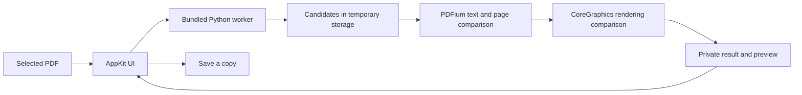

# Architecture

## Components

| Path | Responsibility |
| --- | --- |
| `src/main.swift` | AppKit window, menus, drag/drop, PDFKit preview, worker process, saving, CoreGraphics renderer |
| `src/Localization.swift` | System language resolution, preference, formatting, UI updates |
| `src/optimizer.py` | Candidate generation, checks, command-line protocol |
| `locales/*.json` | Shared UI/worker message catalogs |
| `scripts/prepare_runtime.py` | Project-local public Python runtime and dependencies |
| `build_app.py` | Native compile, bundle assembly, licenses, ad-hoc signing and smoke checks |
| `scripts/make_demo.py` | Original synthetic example for tests and screenshots |
| `tests/` | Worker safety and localization regression tests |

The UI is native AppKit, not a browser wrapper. PDFKit displays the selected document. Optimization runs in a separate process so the window remains responsive. No application component sends documents or analytics over the network.



## Worker protocol

The GUI launches bundled Python with `-I -B`, the bundled worker path, input/output paths, target, mode, language, optional `--repair`, and its executable path as `--native-helper`. Paths are process arguments, not shell interpolation. Isolated mode avoids inherited Python environment configuration; `-B` prevents writes of bytecode into the signed app.

Stdout is newline-delimited UTF-8 JSON:

```json
{"type":"progress","message_key":"progress.pages","values":{"current":2,"total":7},"message":"Processing pages: 2 of 7"}
{"type":"error","message_key":"error.encrypted","message":"This PDF is encrypted. Save an unencrypted copy first."}
```

A `result` event includes `input`, `output`, `preview`, `original_bytes`, `output_bytes`, `pages`, `target_bytes`, `target_met`, `coordinates`, `masks`, `mask_pages`, `images`, `precision`, and `native`. The native object has `checked` and `bad_pages`; an unavailable check can also include `reason`. Generic worker errors may include a technical `diagnostic`; treat it as potentially containing private paths.

The UI translates `message_key` with its current catalog, allowing a language change while a worker started with a different language is running. Do not parse localized prose to make program decisions. CLI exit codes are 0 for completion, 1 for an error, and 130 for interruption. An unmet target is a completed result, not an error.

## File lifecycle

The original is read only. The GUI gives the worker a private staging output path. The worker creates intermediate candidates in a temporary directory, selects an accepted candidate, and creates the staged PDF exclusively. The result remains temporary until the user saves a copy. Save refuses the source path. Cancelling terminates the worker; Python unwinds temporary directories. The GUI removes its staging directory on cleanup.

Forced termination, OS crashes, or power loss can leave temporary files behind; this is ordinary local storage, not secure erasure. The CLI additionally writes adjacent `.json` and `.png` sidecars, so use a fresh basename. The app is not App Sandbox-confined, and PDF parsing happens with the user's process privileges. See [SECURITY.md](../SECURITY.md).

## Native helper

`PDFLight --render-check input.pdf output-directory` invokes the executable without launching the app UI. It renders every page with CoreGraphics to PNG. Python compares those images to PDFium reference images after resampling and blur to reduce antialiasing differences. It flags likely rendering disagreement; it neither clears nor directly verifies Finder's Quick Look cache.

`PDFLight --localization-self-test` checks preferred-language selection and decimal input parsing without UI interaction. `PDFLight --open file.pdf` opens a document in the UI.

## Appearance

The app defaults to the system appearance (`NSApp.appearance = nil`). The header picker can override it with Aqua or Dark Aqua; `PDFLightTheme` stores the preference. AppKit semantic text colors and dynamic surface colors resolve against the effective appearance. Layer-backed panels refresh their CGColor values when that appearance changes, and the PDF viewer updates only its surround. Theme changes do not reload or modify the PDF, change the selected language, or interrupt a worker.
