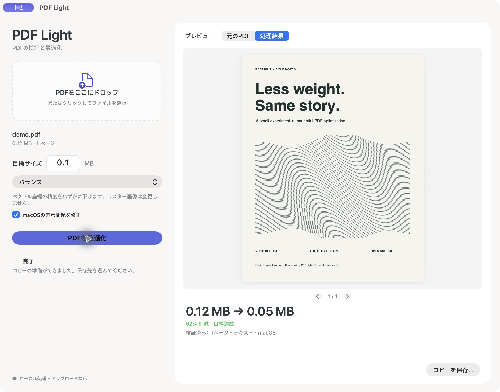

# Localization

Seven UTF-8 JSON catalogs are shared by Swift and Python: `en`, `ru`, `de`, `fr`, `es`, `ja`, `zh-Hans`. The initial translations were AI-assisted; native-speaker review is welcome.

On first launch, `Locale.preferredLanguages` is examined in order. Region variants of the six non-Chinese languages match their base language. All Chinese variants currently resolve to Simplified Chinese. An unsupported preference is skipped in favor of the next supported language; English is the final fallback. Choosing a language in the menu persists the `PDFLightLanguage` preference. Choosing System language restores automatic selection.

The UI uses the system numeric locale in System language mode, and the selected language's locale otherwise. Target input accepts a comma or a dot as the decimal separator, without thousands grouping. Number-only placeholder values passed from Swift are formatted there. Python CLI progress counts are plain integers. Native macOS file dialogs can follow macOS's own language settings.

## Editing translations

1. Edit the corresponding file in `locales/` without changing message keys.
2. Preserve placeholders such as `{count}`, `{size}`, `{current}`, and `{total}` exactly. Their order may change.
3. Use concise, natural UI wording and consistent terminology for lossless, balanced, compact, mask and copy.
4. Prefer count-neutral labels (`Pages: {count}`) where singular/plural forms would differ. The current lightweight catalog system does not implement ICU plural rules.
5. Run the localization tests; then inspect the UI, error messages, progress, and saved state in the affected language. Check minimum window size and long filenames.

Adding a language requires a catalog, entries in `Localization.supported`, `Localization.names`, Python `SUPPORTED`, and the builder's `LANGUAGES`/bundle declarations; update the matching tests and documentation. UI labels are bound to a shared localization service. Dynamic state is refreshed separately so changing language does not discard a loaded document or result.

