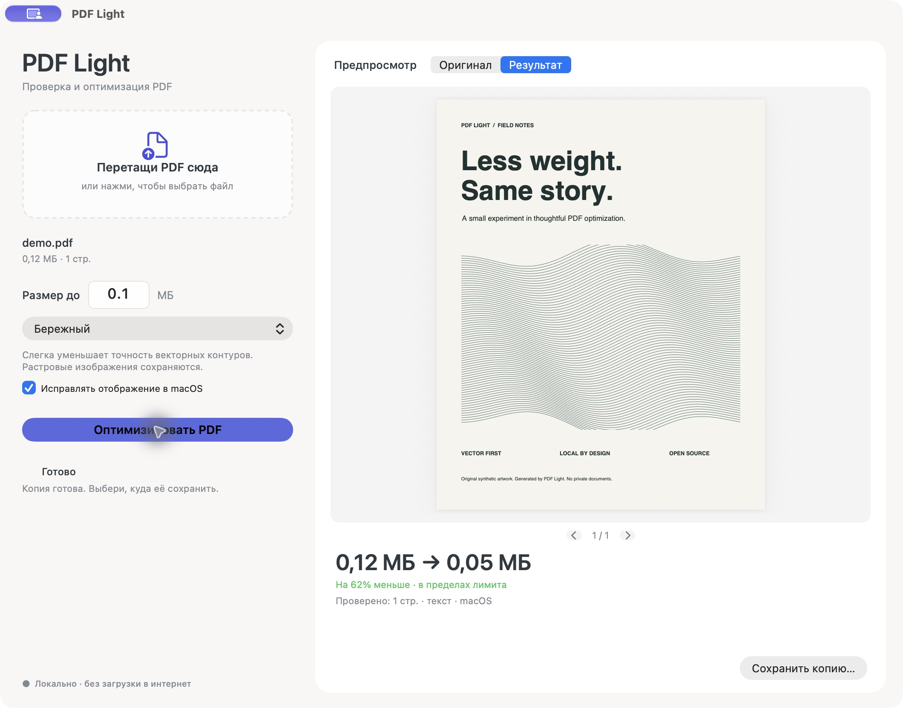

# PDF Light

Небольшое приложение для macOS: уменьшает размер PDF, сравнивает текст и внешний вид страниц и проверяет отображение средствами macOS. Работает локально, без аккаунта и отправки документов в интернет.

[Скачать / релизы](https://github.com/dkomov/pdf-light/releases) · [Основное описание](../README.md) · [Устройство приложения](ARCHITECTURE.md) · [Алгоритмы и ограничения](ALGORITHMS.md) · [История проекта](STORY.md)

## Запуск

Нужен Mac с Apple Silicon и macOS 14 или новее. Распакуй архив релиза и перенеси PDF Light.app в «Программы». Python уже включён в приложение.

Первая открытая сборка имеет локальную подпись, но не прошла нотариальную проверку Apple. При блокировке запуска используй стандартный способ открытия приложения от неизвестного разработчика из настроек macOS, только если доверяешь источнику, или собери приложение из исходников. Глобально отключать защиту macOS не требуется.

## Работа

1. Перетащи PDF в окно или выбери его через меню «Файл».
2. Укажи желаемый размер. 9 МБ — это 9 000 000 байт. Дробную часть можно отделять запятой или точкой.
3. Выбери режим и нажми «Оптимизировать PDF».
4. Сравни оригинал и результат, прочитай результаты проверки, сохрани отдельную копию.

«Без потерь» перепаковывает данные. «Бережный» дополнительно сокращает избыточную точность векторных координат. Компактный режим также сжимает подходящие JPEG-фотографии и может уменьшить их разрешение. Исправление отображения в macOS — отдельная настройка: оно удаляет только распознанные лишние непрозрачные маски на всю страницу.

Язык по умолчанию выбирается из системных предпочтений. В меню «Язык» доступны русский, английский, немецкий, французский, испанский, японский и китайский (упрощённое письмо). Переключение работает сразу.

Достичь указанного размера удаётся не всегда. Приложение проверяет текст и изображения страниц, но это не полноценная проверка PDF/X, PDF/A, интерактивных форм или подготовки к печати. Сохраняй оригинал и проверяй важные документы в целевой программе. Зашифрованные PDF и обнаруженные цифровые подписи не обрабатываются.

Для сборки и участия в проекте см. [Development](DEVELOPMENT.md) и [Contributing](../CONTRIBUTING.md). Код распространяется по [MIT](../LICENSE); сторонние библиотеки сохраняют свои лицензии.

## Сказать спасибо

Если PDF Light пригодился, можно [поддержать автора через PayPal](https://www.paypal.com/donate/?hosted_button_id=V2NMP6RAC2EU2). Это добровольно — все функции приложения остаются бесплатными. Кнопка с сердечком открывает эту же страницу в браузере.
